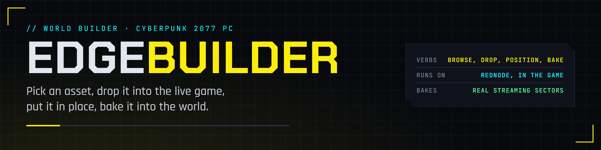
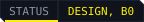

<p align="center">
  
</p>

<p align="center">
  <a href="https://edgemodders.github.io/EDGEbuilder/"></a>
  
  
  
  <a href="LICENSE"></a>
</p>

A world builder for Cyberpunk 2077 that runs inside the game on [REDnode](https://github.com/Edgemodders/REDnode). Pick an asset from the game's own files, drop it into the live world, move it into place, arrange a scene, and bake the scene into a streaming sector that loads like any other mod.

EDGEbuilder is the first mod built on the EDGE platform end to end: the editor is a web page over the game, the logic is Node, [REDbridge](https://github.com/Edgemodders/REDbridge) lists the assets and bakes the sector, the bake lands in a [REDcode](https://github.com/Edgemodders/REDcode) project, and [REDdeck](https://github.com/Edgemodders/REDdeck) installs both the builder and what it builds. The idea comes from World Builder by keanuWheeze, a Cyber Engine Tweaks mod; EDGEbuilder is a from-scratch design that uses none of its code, files or data.

**[Read the design](https://edgemodders.github.io/EDGEbuilder/design.html)** &middot; [REDnode](https://github.com/Edgemodders/REDnode) &middot; [REDbridge](https://github.com/Edgemodders/REDbridge) &middot; [REDcode](https://github.com/Edgemodders/REDcode) &middot; [REDdeck](https://github.com/Edgemodders/REDdeck)

> [!NOTE]
> **Status: B1 passed in game; B2a built, in-game test pending.** EDGEbuilder 0.1.1 reads an index of your game's meshes and entities through REDbridge, searches it, drops a picked asset in front of V through REDnode's world API, selects it with the game's own outline, deletes it, and brings the scene back after a save loads. Results: [B1 test](https://edgemodders.github.io/EDGEbuilder/b1-test.html). Next: B2, positioning with a gizmo. Install it with REDdeck from the [releases page](https://github.com/Edgemodders/EDGEbuilder/releases). The [design](https://edgemodders.github.io/EDGEbuilder/design.html) says where it goes.

## How it works

```
 Browse        Drop               Position              Arrange           Bake
 ──────        ────               ────────              ───────           ────
 REDbridge     a preview entity   a gizmo drawn by      groups, undo,     REDbridge writes the
 lists the     spawns through     the overlay; each     scene files       streaming sector; REDcode
 game's own    the game API       change sets its       in the project    packs it; REDdeck deploys
 assets                           world transform                         it; restart: it is real
```

| Behaviour | What you do | What EDGEbuilder does |
|---|---|---|
| **Browse** | Search the game's meshes, entities, lights and more by kind | REDbridge reads the game's archives once per game version and keeps an index |
| **Drop** | Pick one and it appears in front of you, or on the surface under the cursor | Spawns a preview entity with the right component through REDnode's game API |
| **Position** | Move, rotate, scale with a gizmo or the keys G, R, S; type numbers; drop to the floor | Draws the gizmo over the game and sets the preview's transform |
| **Arrange** | Group, duplicate, hide, undo, save | Keeps the scene tree and writes a scene file |
| **Bake** | Name the scene, pick a REDcode project, press Bake | REDbridge writes the sector, the streaming block and the ArchiveXL file into the project; REDdeck installs it |

Two halves share the scene file: the **runtime builder** in the game, where what you see is what you get, and the **project builder** in REDcode, where you tidy, validate and bake with the game closed.

## Layout

| Path | Contents |
|---|---|
| `edgebuilder/` | The REDnode package: `rednode-app.json`, the editor page and the Node mod |
| `src/` | TypeScript for both halves of the package, built into `edgebuilder/` by `npm run build`; `npm run smoke` tests the REDnode-free parts against a real REDbridge and game |
| `docs/` | Documentation site: the design and the dev setup |
| `tools/` | `deploy.ps1` copies the package into the game; `brand/` generates the banner, icon and badges |

## Roadmap

- **B0 Decide.** The design, the repo, a package that installs and opens an empty window. Done.
- **B1 Browse and drop.** The asset index from REDbridge; drop a mesh and an entity; select, delete. Passed in game 2026-10-13.
- **B2a Position.** The Edit switch, the gizmo, picking in the world, G R S, numbers, drop to floor, mesh scale. Built, in-game test pending.
- **B2b Camera.** The editor camera.
- **B3 Arrange and save.** Groups, multi-select, duplicate, undo and redo, scene files.
- **B4 Bake.** `sector.build` in REDbridge, the bake panel, the scene in the REDcode project, install through REDdeck.
- **B5 Lights and more kinds.** Lights, decals, particles, effects, sounds, colliders.
- **B6 Comfort.** Favourites, prefabs, scatter, snapping, templates.
- **B7 Project builder.** The scene in REDcode with the game closed, then a 3D view.

## Legal

MIT. This repository contains no game files, no mod files and no data extracted from the game; the asset index is built on the player's machine from the player's own game. Single-player modding only. World Builder is keanuWheeze's; EDGEbuilder shares its idea, not its code. REDengine and Cyberpunk 2077 are CD PROJEKT's.
